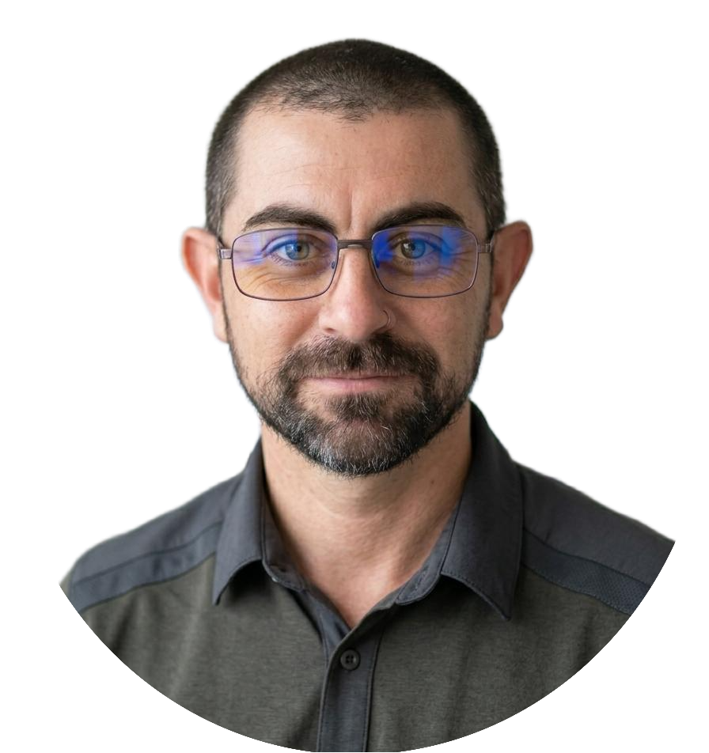

# Mauricio Pintos 

**Infraestructura IT & Redes | Desarrollador Fullstack | Docente Universitario**  
📍 Buenos Aires, Argentina  

---

### 👨‍💻 Sobre mí

Tengo más de 15 años de experiencia en administración de servidores, redes y soporte crítico en el Poder Judicial de la Provincia de Buenos Aires, combinados con más de 4 años como docente universitario en carreras de informática (UNAHUR).

Trabajo conectando la infraestructura tradicional (Linux/Windows Server, PowerShell, Firewalls, backups) con el desarrollo de software actual (Java, TypeScript, Nest.js, React). Me enfoco en escribir código limpio, automatizar tareas repetitivas y aplicar metodologías claras tanto en producción como en el aula.

---

### 🧰 Stack Tecnológico

* **Backend & Lenguajes:** Java, TypeScript, JavaScript, Python, Kotlin, Node.js / Nest.js, APIs REST
* **Frontend:** React, Next.js, Tailwind CSS
* **Bases de Datos:** SQL Server, MySQL, MongoDB
* **Infraestructura & Scripting:** PowerShell, Bash, Windows Server, Linux, Active Directory / GPO, VMware, Fortinet FortiGate, SCCM
* **Testing & Modelado:** JUnit, Mockito, UML

---

### 🧾 Proyectos Destacados

#### 🌐 [JuntadApp](https://juntadapp.com.ar)
Aplicación web productiva con arquitectura *Backendless* centrada en la privacidad del usuario.
* **Persistencia descentralizada:** Sin base de datos propia; interactúa directamente con la API de Google Sheets guardando los datos en el Google Drive del usuario.
* **Autenticación:** Integración nativa con Google OAuth para manejo de sesiones.

#### 🧩 [Asistencia SIU Guaraní PRO](https://github.com/mauriciopintos/siu-auto-asistencia)
Extensión de navegador (Chrome, Edge, Firefox) para la automatización de procesos administrativos académicos.
* **Funcionalidad:** Procesa listas de DNIs desde texto o Excel, aplica limpieza de formato y automatiza el marcado de asistencia con scroll interactivo en la interfaz de SIU Guaraní.
* **Stack:** JavaScript Vanilla, Chrome Extension APIs (Content Scripts / Manifest v3), CSS.

#### 🤖 [API-EDEN (Extraer Entidades Nombradas)](https://github.com/mauriciopintos/API-EDEN-JWT)
API REST en Flask para el reconocimiento y procesamiento de lenguaje natural (NLP) sobre datos sensibles.
* **Procesamiento híbrido:** Extracción y estructuración de datos (DNIs, patentes, correos, cuentas) integrando SpaCy, Expresiones Regulares (RegEx) y la API de OpenAI (GPT).
* **Seguridad:** Autenticación y control de acceso mediante tokens JWT (JSON Web Tokens).

#### 🎟️ [BeEvents Backend REST](https://github.com/DesApp-2024c1-Grupo4/beevents-back)
API REST para gestión y venta de entradas a eventos.
* **Tecnologías:** Nest.js, MongoDB, Mongoose, Render.
* **Rol:** Diseño del modelo de dominio, estructura de la base de datos y endpoints REST.

#### 🔐 Sistema Automatizado de Backups (APH)
Solución de respaldos automatizados desarrollada con scripts de PowerShell y SQL Server para el Poder Judicial.
* Incluye replicación en múltiples sitios, control de integridad de datos y copias desconectadas (*offline*) para protección contra ransomware.
* Estandarizado y utilizado en 20 departamentos judiciales.

#### 💻 [AsignaRepos](https://unahur-materias.github.io/)
Herramientas e iniciativas web para la automatización y gestión de materias universitarias (UNAHUR).

---

### 🎓 Docencia Universitaria

**Universidad Nacional de Hurlingham (UNAHUR)** — *Docente / Ayudante Concursado*
* Programación Estructurada & Lógica
* Programación Orientada a Objetos 1 y 2 (Java, Wollok, Patrones de Diseño GoF)
* Bases de Datos

---

### 📜 Formación Académica

* **Tecnicatura Universitaria en Programación** — UNAHUR *(Egresado)*
* **Licenciatura en Informática** — UNAHUR *(En curso)*
* **Tecnicatura Universitaria en Redes y Operaciones** — UNAHUR *(En curso)*

---

💡 *"La claridad en el diseño es respeto por quien mantiene el código."*

<!--
🎯 Profesional IT | Desarrollador Fullstack | Infraestructura IT N2/N3 | Docente Universitario  
📍 Buenos Aires, Argentina  

---

## 👨‍💻 Perfil Profesional

Profesional IT con más de 15 años de experiencia en infraestructura y soporte técnico en el Poder Judicial de la Provincia de Buenos Aires, y más de 4 años en docencia universitaria en carreras de informática.

Combino experiencia en entornos productivos críticos con desarrollo de software, diseño de APIs, modelado orientado a objetos y automatización de procesos.

Me interesa participar en proyectos donde pueda integrar desarrollo, arquitectura y visión organizacional, aportando criterio técnico y capacidad de resolución.

---

## 🏢 Experiencia Profesional

### 🏛️ Poder Judicial de la Provincia de Buenos Aires (2010 – Actualidad)

**Soporte Técnico IT N2 / N3 (MPBA)**  
- Diagnóstico y resolución de incidentes críticos en entornos productivos  
- Soporte a usuarios institucionales de alto perfil  
- Administración de servidores Windows y Linux  
- Gestión de infraestructura de red y bases de datos  

**Responsable Técnico Departamental (SCBA)**  
- Liderazgo y supervisión de equipo técnico  
- Administración integral de infraestructura (servidores, redes y bases de datos)  
- Migraciones de sistemas y coordinación interdepartamental  
- Desarrollo de automatizaciones que optimizaron tareas operativas  
- Implementación de documentación y estandarización de procesos replicados en otros departamentos  

---

## 🎓 Docencia Universitaria

### Universidad Nacional de Hurlingham (UNAHUR)

**Docente de**
- Programación Estructurada (Gobstones)
- Programación Orientada a Objetos 2 (Java y patrones de diseño)

**Ayudante de cátedra concursado**
- Introducción a la Lógica y Problemas Computacionales
- Programación Estructurada

**Enfoque docente:**
- Metodología formal (Top-Down, contratos, recorridos)
- Diseño orientado a objetos basado en patrones clásicos (GoF)
- Énfasis en claridad, buenas prácticas y pensamiento algorítmico

---

## 🛠️ Stack Técnico

### 💻 Desarrollo
**Backend**
- Java (POO, patrones)
- Python / C# (concurrencia)
- Node.js / Nest.js
- APIs REST (arquitectura MVC)

**Frontend**
- React / Next.js
- TypeScript
- Tailwind

**Base de datos**
- MSSQL / MySQL
- MongoDB (Mongoose)

**Testing y Calidad**
- JUnit / Mockito
- Jest
- JaCoCo

**Modelado**
- UML

### 🖥️ Infraestructura
- Windows Server
- Linux
- MSSQL / MySQL
- Redes corporativas
- Troubleshooting N2/N3
- Automatización mediante scripts
- Herramientas de virtualización: VMware / Hyper-V / VirtualBox
- Gestión de Servicios en la nube: AWS / Azure
- Gestión de Exchange (On-premise)
- Gestión de Active Directory (Cuentas, OUs, GPO)

---

## 📂 Proyectos Destacados

### 🔹 BeEvents – Plataforma de gestión de eventos

Proyecto de Práctica Profesional Supervisada.  
Plataforma de gestión y venta de tickets para eventos.

- Arquitectura: REST
- Rol: Diseño de arquitectura backend, modelado de dominio implementación de API REST
- Tecnologías: Nest.js / Mongoose
- Deploy: https://beevents.onrender.com  
- Backend: https://github.com/DesApp-2024c1-Grupo4/beevents-back.git  

---

### 🔹 Concurrencia, Hilos y Sockets (Sistemas Operativos)

Proyectos académicos orientados a la implementación de comunicación entre procesos y manejo de concurrencia.

- Tecnologías: C#
- Objetivo: Simulación y resolución de problemas clásicos de sincronización

Repositorios:
- https://github.com/mauriciopintos/TP_Final_SO_Sockets.git  
- https://github.com/mauriciopintos/TP_Final_SO_Hilos.git  

---

### 🔹 Desarrollo Web para clientes (producción real)

**Sitios implementados en entornos productivos:**
- Deploy en producción
- Gestión de dominio y hosting
- Mantenimiento post-producción

**Tecnologías:** Next.js / Tailwind
**Rol:** Diseño y desarrollo frontend, asesoramiento técnico y puesta en producción

**Proyectos:**
- https://cinnamonweb.com.ar/  
- https://lcseguridadelectronica.com.ar/  
- https://clases-dev.onrender.com  
---

## 🎓 Formación Académica

- Licenciatura en Informática – UNAHUR (43% – Promedio 8.53)
- Tecnicatura Universitaria en Redes y Operaciones – UNAHUR (65% – Promedio 8.33)
- Tecnicatura Universitaria en Programación – UNAHUR
- Ingeniería en Informática – UNLaM (cursado hasta 2° año)
- Técnico Mecánico – Mercedes-Benz Argentina (Sistema Dual)

---

## 🧠 Competencias

- Liderazgo técnico
- Resolución de problemas complejos
- Documentación estructurada
- Pensamiento analítico
- Trabajo en equipo
- Orientación al servicio
- Aprendizaje continuo

---

## 📫 Contacto

📧 mauricioenrique.pintos@estudiantes.unahur.edu.ar  
🔗 LinkedIn: https://tinyurl.com/LN-PerfilMEP  

---

_“La claridad en el diseño es respeto por quien mantiene el código.”_
-->
