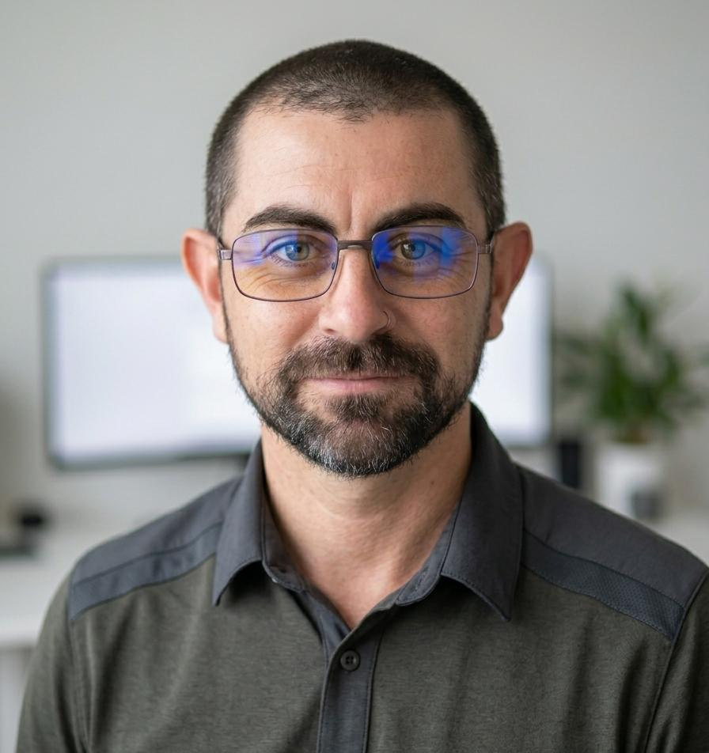

<!-- CV-MauricioPintos-Infra_SecOps.md -->
<!-- CV 4 - Para Infraestructura / DevOps -->

<!-- # Mauricio Pintos  -->

# Mauricio Pintos 

📍 **Buenos Aires, Argentina** | 📱 +54 9 11 6583-5046
📧 [mauricio.pintos@unahur.edu.ar](mailto:mauricio.pintos@unahur.edu.ar)
🔗 [LinkedIn](https://www.linkedin.com/in/mauricio-pintos-783272240) | 💻 [GitHub](https://github.com/mauriciopintos)

#### Profesional IT | Datos, Integración, Bases de Datos y Automatización

---

## Perfil Profesional

Profesional IT con más de 15 años de experiencia en entornos productivos críticos, combinando administración de sistemas, bases de datos, integración de soluciones, automatización y desarrollo de software.

Experiencia en SQL Server, MongoDB, modelado de datos, APIs REST, integración entre sistemas, automatización mediante scripting y control de integridad de información, participando en proyectos tecnológicos de alcance institucional.

Experiencia liderando proyectos técnicos, normalizando procesos y resolviendo problemas complejos en organizaciones con infraestructura distribuida y alta demanda operativa.

Actualmente complemento mi experiencia profesional con docencia universitaria en programación y bases de datos, aportando una perspectiva metodológica orientada al análisis, modelado y resolución de problemas.

---

## Competencias Técnicas

#### Datos y Bases de Datos

- SQL Server / MSSQL
- MongoDB
- SQL
- Modelado de datos
- Integridad y consistencia de información
- Persistencia y almacenamiento de datos
- Diseño y consumo de APIs REST
- Integración de sistemas y servicios

#### Integración y Automatización

- PowerShell
- Bash
- Python
- APIs REST
- Automatización de procesos
- Git / GitHub
- GitHub Actions
- Docker
- Integración de servicios Cloud

#### Desarrollo

- Java
- Python
- JavaScript / TypeScript
- Node.js / Nest.js
- APIs REST
- Arquitectura orientada a servicios
- Testing y validación de software
- Modelado UML

#### Infraestructura y Plataformas

- Windows Server
- Linux
- Active Directory / GPO
- VMware / Hyper-V
- SCCM
- Redes corporativas
- FortiGate / VPN
- Administración de entornos productivos

---

## Experiencia Profesional

### Poder Judicial de la Provincia de Buenos Aires

##### 2010 – Actualidad

#### Soporte Técnico IT / Especialista IT – MPBA

##### Diciembre 2025 – Actualidad

- Diagnóstico y resolución de incidentes técnicos en sistemas y plataformas del organismo.
- Mantenimiento operativo y soporte de infraestructura tecnológica.
- Análisis y resolución de problemas en entornos productivos.

#### Responsable Técnico Departamental – SCBA

##### 2021 – Diciembre 2025

- Lideré la gestión técnica del área y coordiné proyectos interdepartamentales de infraestructura y normalización de procesos.
- Administré servidores Windows/Linux, Active Directory y políticas de grupo.
- Diseñé e implementé el sistema automatizado de backups APH, con replicación multi-site y estrategia de aislamiento anti-ransomware.
- El proyecto incorporó mecanismos de control de integridad de bases de datos y replicación de información entre distintos destinos.
- La solución fue tomada como referencia para su implementación en 20 departamentos judiciales.
- Coordiné la resolución de incidentes y problemas técnicos en infraestructura distribuida.

#### Soporte Técnico IT N2/N3 / Administrador de Sistemas

##### 2010 – 2021

- Implementé soluciones automatizadas para despliegue masivo y administración de sistemas mediante Clonezilla, MDT, Sysprep y SCCM.
- Desarrollé automatizaciones mediante PowerShell, Bash y Python para optimizar procesos operativos.
- Diseñé e implementé la infraestructura de virtualización necesaria para la transición del sistema de gestión Lex-Doctor al sistema vigente.
- Participé en la integración y coexistencia de tecnologías durante una migración implementada en 19 departamentos judiciales.
- Realicé troubleshooting avanzado y resolución de incidentes críticos en entornos de producción.

---

#### Proyectos Técnicos Destacados

##### Plataforma APH – Respaldo Distribuido e Integridad de Datos

Diseño e implementación de una solución automatizada de respaldo y resiliencia utilizando PowerShell, SQL Server, replicación multi-site y almacenamiento aislado offline.

- Automatización de procesos de respaldo.
- Replicación de información entre distintos sitios.
- Control de integridad de bases de datos.
- Estrategia de aislamiento frente a ransomware.
- Implementación a escala institucional.

##### BeEvents – Backend REST

Diseño e implementación de una plataforma backend orientada a servicios utilizando Nest.js, MongoDB y Mongoose.

- Diseño de API REST.
- Modelado de datos.
- Persistencia en MongoDB.
- Integración de servicios.
- Desarrollo y despliegue de la aplicación en producción.

##### JuntadApp – Aplicación Cloud / Backendless

Aplicación web productiva basada en arquitectura desacoplada.

- Integración con Google Sheets API para persistencia distribuida.
- Integración con servicios de Google Cloud.
- Implementación de autenticación mediante Google OAuth.
- Diseño de una arquitectura donde la aplicación no centraliza los datos de los usuarios.

---

### Experiencia Docente

##### Universidad Nacional de Hurlingham – UNAHUR

Docente Universitario | 2022 – Actualidad

- Programación Estructurada.
- Programación Orientada a Objetos.
- Bases de Datos.
- Testing unitario.
- Modelado UML.
- Arquitectura y buenas prácticas de desarrollo.
- Análisis y resolución de problemas computacionales.
- Diseño y evaluación de trabajos prácticos y proyectos.

La actividad docente complementa la experiencia profesional con capacidad para analizar requerimientos, estructurar problemas complejos, documentar soluciones y comunicar conceptos técnicos.

---

### Formación Académica

- **Tecnicatura Universitaria en Programación – UNAHUR — Egresado.**
- Licenciatura en Informática – UNAHUR — En curso.
- Tecnicatura Universitaria en Redes y Operaciones – UNAHUR — En curso.
- Ingeniería en Informática – UNLaM — 2.º año completo.
- Técnico Mecánico – Mercedes-Benz Argentina.

---

#### Idiomas

- Español: nativo.
- Inglés: conocimientos técnicos.